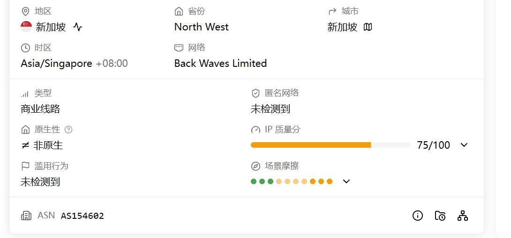
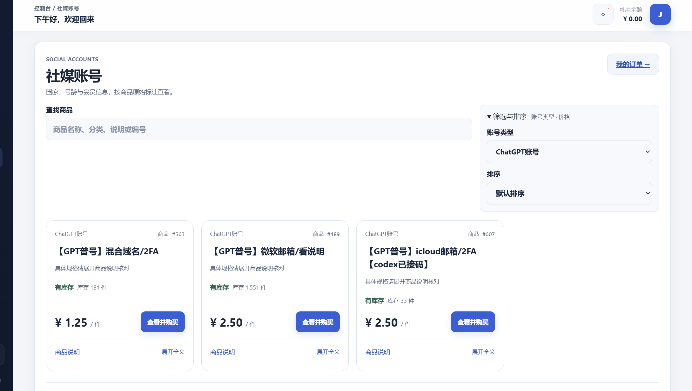
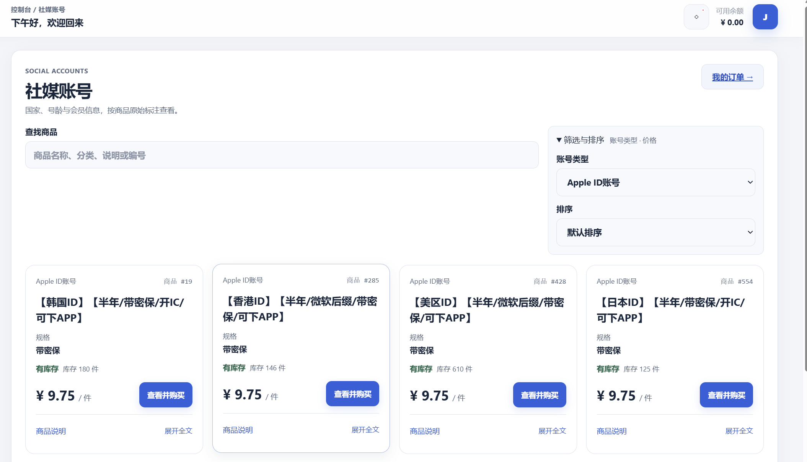
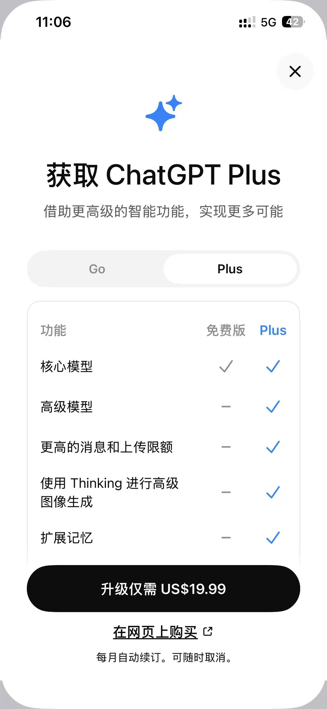
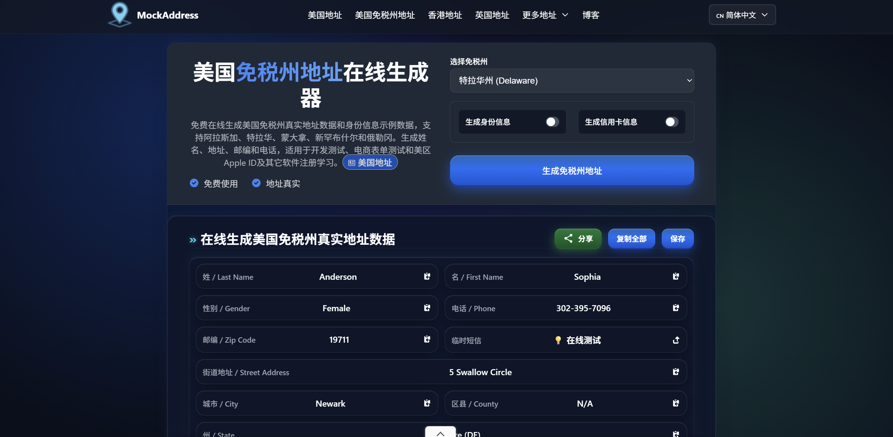
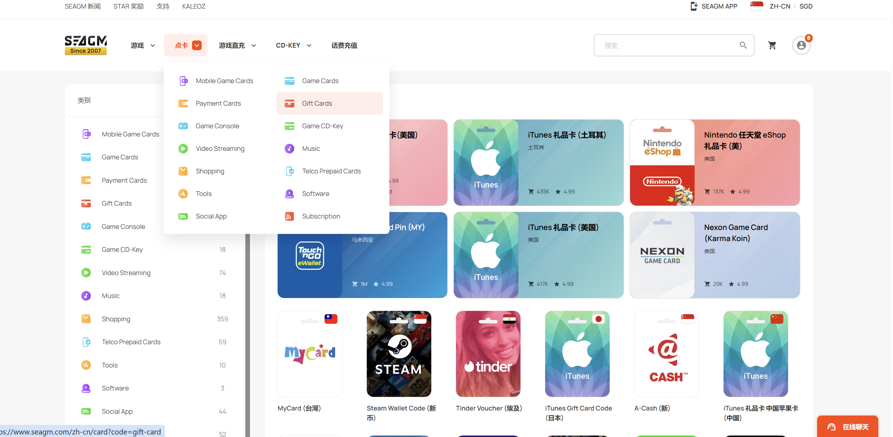
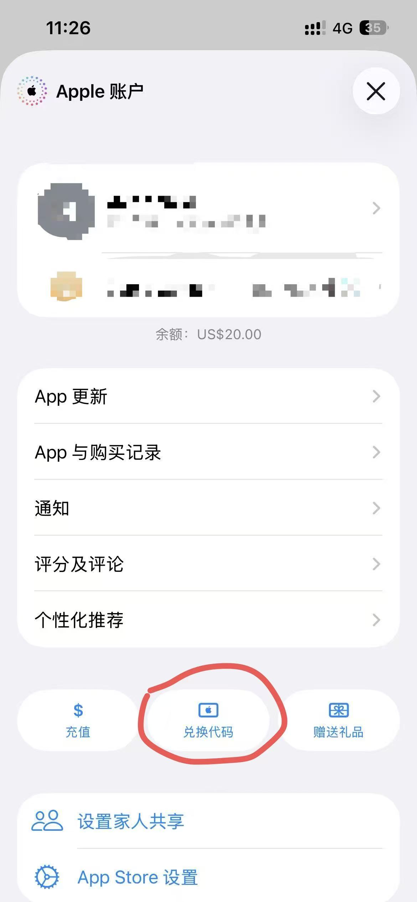
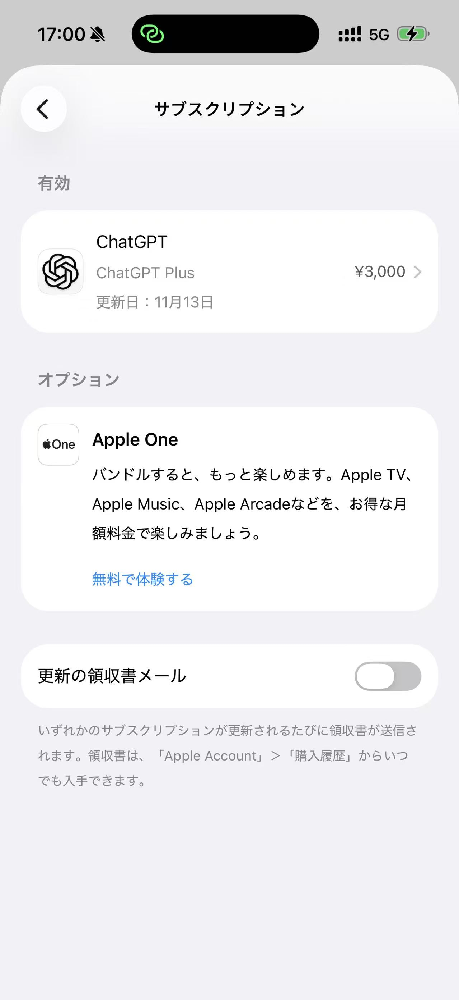

# iPhone 上通过 App Store 订阅 ChatGPT

这份中文教程介绍如何检查 ChatGPT 登录、选择与 Apple 账户同区的礼品卡、兑换充值，以及查看订阅和续订日期。

文中包含美区美元界面和日区日文界面的截图。界面、金额和日期均为示例，请以自己的账户页面和购买确认页为准。

文档更新于 2026 年 11 月 19 日。

## 一站式订阅推荐

如果想在同一个平台购买 **ChatGPT 和 Gemini** 订阅，可以看看这个第三方入口。下单前请确认所选套餐是否包含 **30 天质保**，具体保障范围和售后条件以商品页为准。[查看订阅套餐](https://accboyytbetw.acceboy.com/)

这份指引以 iPhone 上的 ChatGPT Plus 为例。先确认网络和 ChatGPT 账号能用，再准备 App Store 账户、下载应用和检查订阅页面。

## 第一步：确认 VPN 可以正常使用

本指引使用的是 [SakuraCat 注册链接](https://c4-sakuracat.com/register?code=WqtZ9l1U)。如果你已经有可用的 VPN，可以继续用自己的。

1. 连接 VPN，选择中国大陆以外的节点，建议先试新加坡、日本或美国。
2. 如果 VPN 客户端有“全局”选项，手机上建议先开启，再进行下面的测试。
3. 用准备订阅的手机打开 [IPCheck.ing](https://ipcheck.ing/?hl=zh)，检查出口 IP 的地区和 IP 质量分。建议选 **70 分及以上**的节点。这是本指引的参考值。如果分数偏低，可以换个节点再测。

## 第二步：确认 ChatGPT 账号能正常使用

在手机浏览器打开 [ChatGPT](https://chatgpt.com/)，用你平时的方式登录，发一条消息试试。能收到回复，就可以继续准备 App Store 账户。

如果还没有 ChatGPT 账号，可以在官网注册。原素材也提供了一个[第三方商品页](https://yinliugo.com/#digital-goods)，其中有商家标注为“Codex 已接码”的商品。“已接码”是商家描述，后续仍可能出现验证提示。

## 第三步：准备外区 Apple 账户并下载 ChatGPT

如果你已经有能登录 App Store 的美区或日区 Apple 账户，可以跳过账户准备，直接下载。还没有的话，可以先参考 [Apple 的账户注册说明](https://support.apple.com/zh-cn/108647)。原素材提供的[第三方商品页](https://yinliugo.com/#digital-goods)也列出了美区和日区账户，页面上的价格和库存仅为截图时的示例。

1. 打开 App Store，点右上角的头像，使用你准备好的 Apple 账户登录 App Store。
2. 搜索 **ChatGPT**，确认开发者为 **OpenAI**，然后下载并打开应用。
3. 用第二步确认可用的 ChatGPT 账号登录应用。

## 第四步：打开订阅页面

在 ChatGPT 应用里点“升级”，也可以从应用的设置中找升级入口。**看到套餐介绍、价格和升级按钮，就算通过这一步。先不用付款。** 实际显示的套餐和金额以你手机上的页面为准。

## 第五步：检查 Apple 付款与账单信息

如果需要新增或修改付款方式，在 iPhone 上前往 **设置 → 你的姓名 → 付款与配送**。选择添加或编辑付款方式，填写与该付款方式相符的账单地址并保存。部分购买即使用 Apple 账户余额支付，也可能要求账户已登记信用卡。详见 [Apple 账户余额使用说明](https://support.apple.com/zh-cn/118245)。

如果对美区地址格式不熟悉，可以用 [MockAddress（美国免税州地址生成器）](https://mockaddress.com/) 查看街道、城市、州和邮编的填写示例。

## 第六步：购买 Apple 礼品卡并充值

1. 下单前，在 iPhone 上打开 **设置 → 你的姓名 → 媒体与购买项目 → 查看账户 → 国家/地区**，核对用于订阅的 Apple 账户地区。部分系统版本会直接显示「国家/地区」。详见 [Apple 账户地区说明](https://support.apple.com/zh-cn/118283)。

   本指引使用 SEAGM 购买 Apple 礼品卡。选卡时看商品标注的地区，**美区账户买美区卡，日区账户买日区卡**，其他地区以此类推。截图右上角显示的是网站语言和结算币种。地区核对无误后，再按订阅金额选面额并下单。购买入口：[SEAGM](https://www.seagm.com/)。

   

2. 打开 App Store，用准备用于订阅的 Apple 账户登录。点右上角的头像进入账户页面，再点 **兑换代码**，手动输入刚刚购买的礼品卡卡密并确认兑换。[Apple 兑换说明](https://support.apple.com/en-us/118242)
3. 兑换后回到 App Store 账户页面，查看顶部账户资料下方的 **余额**，确认充值金额已到账。截图中的 US$20.00 是示例。确认余额足够支付订阅金额后，再继续下一步。

   

## 第七步：完成订阅并查看续订日期

1. 确认 Apple 账户余额到账后，回到 ChatGPT 应用的订阅页面，选择套餐并点升级。在 Apple 的购买确认界面核对套餐、金额和续订信息，再确认付款。完成后，回到 ChatGPT 检查当前账号是否已显示所购买的套餐。
2. 打开 **App Store → 右上角头像 → 订阅**，在有效订阅列表中找到 **ChatGPT**，查看套餐、续订金额和日期。也可以从 **设置 → 你的姓名 → 订阅** 进入。日文界面上的「更新日」就是续订日期，截图里的金额和日期仅供参考。[Apple 的订阅管理说明](https://support.apple.com/zh-cn/118428)

   

3. 如果打算继续订阅并用 Apple 账户余额续费，在下次扣款前检查余额。不够的话，按第六步购买并兑换同地区的礼品卡，确认余额到账并足以支付下一期账单。

如果订阅按钮显示应用内购买暂不可用，可以稍后重试。详见 [OpenAI 的 iOS 订阅帮助](https://help.openai.com/zh-hans-cn/articles/7905739-chatgpt-ios-app-upgrading-to-a-paid-subscription)。

### Apple 已扣款，但 ChatGPT 仍显示免费版

1. 打开 Apple 的订阅列表，确认 ChatGPT 订阅处于有效状态。
2. 确认 App Store 使用的是付款时的 Apple 账户，并登录购买时使用的 ChatGPT 账号。在 ChatGPT iOS 应用里打开 **设置 → 账户 → 恢复购买**。
3. 如果恢复后仍显示免费版，保留 Apple 收据和错误信息，联系 OpenAI 支持。排查期间先别重复购买。详见 [OpenAI 的订阅排查指南](https://help.openai.com/en/articles/20001056-troubleshooting-chatgpt-subscription-access-and-account-changes)。

## 免责声明

本教程是个人操作经验分享，与 Apple、OpenAI 及文中提到的第三方平台无隶属关系。截图中的界面、金额和日期仅供参考。各地区的套餐、价格、税费、付款和退款规则可能变化，请以实际购买页面及平台当时的规则为准。

第三方链接仅用于说明文中提到的操作入口，不构成对商家或商品的背书。购买前请自行核对商品地区、到账方式及售后条款。本教程不保证充值、订阅或续订成功。遇到付款或退款争议，请联系对应交易平台的客服。
